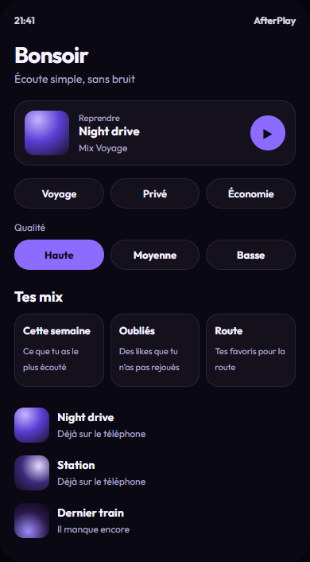
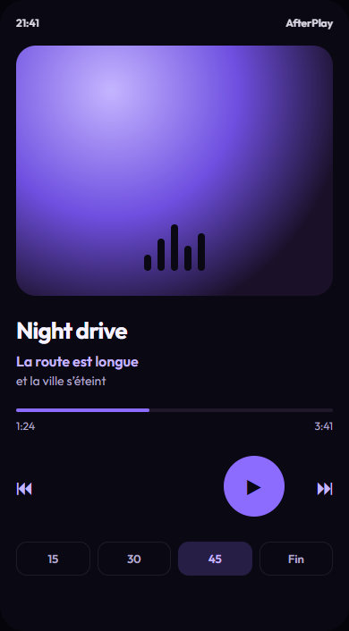

# AfterPlay

Lecteur Android. La musique continue quand le réseau lâche.

**[Télécharger sur afterplay.dev](https://afterplay.dev)**

  
  

- Likes, playlists et fichiers du téléphone, sans compte
- La ligne de paroles en cours suit le titre
- Qualité Haute, Moyenne ou Basse
- Mode Voyage : déjà sur le téléphone, ou encore à télécharger

---

Android player. Music keeps going when the network drops.

**[Download at afterplay.dev](https://afterplay.dev)**

- Likes, playlists and files on the phone, no account
- The current lyric line follows the title
- High, Medium or Low quality
- Trip mode: already on the phone, or still to download

AfterPlay est une appli à part, modifiée par Vander, basée sur RiMusic (GPL-3.0). Le code n’est pas dans ce dépôt.
